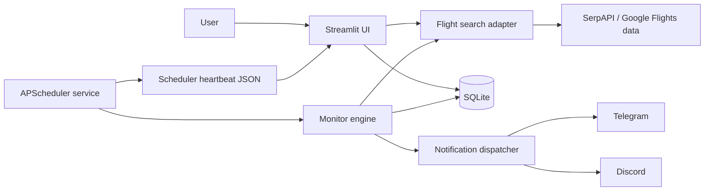

# Architecture

SkyWatch is a local-first Streamlit application with a separate scheduler
process. The web application never starts a second production scheduler.

## Modules

- `app.py`: six-page UI, health surfaces, search and monitor controls.
- `scheduler.py`: production APScheduler service, timezone, process lock, and
  heartbeat persistence.
- `src/flight_api.py`: validation and external flight-search adapter.
- `src/monitor.py`: quote persistence, alert policy, message construction, and
  scheduler-window deduplication.
- `src/notifier.py`: per-channel exact-payload claim and delivery.
- `src/database.py`: SQLite schema, migrations, WAL, foreign keys, and atomic
  notification claims.

## Duplicate-notification controls

1. APScheduler limits each job to one in-process instance.
2. `data/scheduler.lock` prevents concurrent scheduler processes from checking
   the same monitor set.
3. A database claim prevents concurrent delivery in the same notification
   window.
4. A second per-channel fingerprint blocks an identical message payload even if
   it arrives through another trigger path.
5. Successful external notifications participate in the configurable cooldown.

Failed channel deliveries release their payload claim so a later run can retry.

## Data and trust boundaries

- Secrets are read from `.env` and must never be committed.
- SQLite and logs remain local and are excluded from Git.
- The UI binds to loopback by default and has no built-in multi-user auth.
- External flight data and booking links must be confirmed with the provider
  before purchase.
