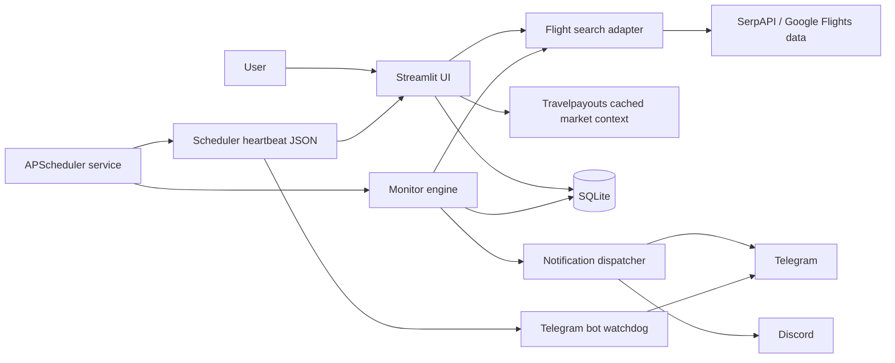

# Architecture

SkyWatch is a local-first Streamlit application with a separate scheduler
process. The web application never starts a second production scheduler.

## Modules

- `app.py`: eight-page light operations UI covering search, monitoring,
  price intelligence, run history, settings, and credential-free backups.
- `scheduler.py`: production APScheduler service, timezone, process lock, and
  heartbeat persistence.
- `src/flight_api.py`: validation, SerpAPI adapter, and operation telemetry.
- `src/travelpayouts.py`: cached Data API market reference for manual searches.
- `src/api_usage.py`: monthly quota summaries, projections, and warning policy.
- `src/monitor.py`: quote persistence, alert policy, message construction, and
  scheduler-window deduplication.
- `src/notifier.py`: per-channel exact-payload claim and delivery.
- `src/database.py`: SQLite schema, migrations, WAL, foreign keys, and atomic
  notification claims.

## Duplicate-notification controls

1. One durable supervisor owns fixed, daily, and interval slots; sleep/wake
   misfires cannot create a second shifted schedule.
2. `data/scheduler.lock` prevents concurrent scheduler processes from checking
   the same monitor set.
3. A database claim prevents concurrent delivery in the same notification
   window.
4. A second per-channel fingerprint blocks an identical message payload even if
   it arrives through another trigger path.
5. Fixed schedule slots and per-channel payload claims prevent duplicate delivery.
6. Stale `running` ledger leases are atomically reclaimed after a crash.

Failed channel deliveries release their payload claim so a later run can retry.

## Fare-search and quota flow

1. Every run starts with one primary fare search.
2. The selected quota mode hard-caps the run at 1, 2, or 5 provider requests.
3. Standard mode may enrich the best return itinerary. Full mode prioritizes
   return details for the best itinerary and each matched Taiwanese
   full-service airline, while repeated departure tokens share one lookup.
4. Booking-provider details are target-hit only and use any budget remaining
   after those return-itinerary priorities.
5. Every attempted request is counted by provider and operation. No route, date,
   passenger, credential, or response content is written to usage telemetry.
6. A database claim permits one quota warning per provider, month, and threshold.

Travelpayouts is deliberately outside the alert path. It runs only with a
user-initiated UI search, is labelled as cached, and cannot cause a target-price
hit or Telegram notification.

## Data and trust boundaries

- Secrets are read from `.env` and must never be committed.
- SQLite and logs remain local and are excluded from Git.
- The UI binds to loopback by default and has no built-in multi-user auth.
- External flight data and booking links must be confirmed with the provider
  before purchase.
