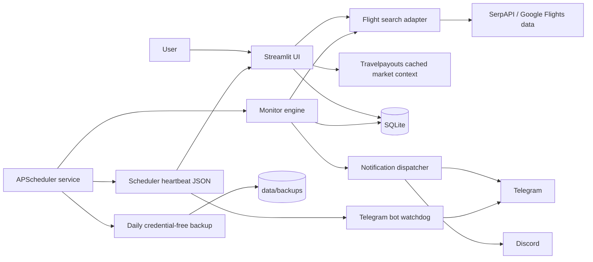

# Architecture

SkyWatch is a local-first Streamlit application with a separate scheduler
process. The web application never starts a second production scheduler.

## Modules

- `app.py`: eight-page light operations UI covering search, monitoring,
  price intelligence, run history, settings, and credential-free backups.
- `scheduler.py`: production APScheduler service, timezone, PID/start-fingerprint
  lifetime ownership, transient provider retries, atomic heartbeat persistence,
  and daily credential-free backup supervision.
- `src/flight_api.py`: validation, SerpAPI adapter, and operation telemetry.
- `src/travelpayouts.py`: cached Data API market reference for manual searches.
- `src/api_usage.py`: monthly quota summaries, projections, and warning policy.
- `src/monitor.py`: quote persistence, alert policy, message construction, and
  scheduler-window deduplication.
- `src/notifier.py`: per-channel exact-payload claim and delivery.
- `src/database.py`: SQLite schema, migrations, WAL, foreign keys, and atomic
  notification claims.

## Duplicate-notification controls

1. One durable supervisor owns fixed, daily, and interval slots; sleep/wake
   misfires cannot create a second shifted schedule.
2. `data/scheduler.lock` is held for the scheduler's complete process lifetime.
   Its JSON owner includes PID, process-start fingerprint, and a random nonce;
   stale recovery never trusts file age alone. A separate short-lived dispatch
   lock prevents a direct legacy job from overlapping the supervisor batch.
3. A database claim prevents concurrent delivery in the same notification
   window.
4. A second per-channel fingerprint blocks an identical message payload even if
   it arrives through another trigger path.
5. Fixed schedule slots and per-channel payload claims prevent duplicate delivery.
6. Stale `running` ledger leases are atomically reclaimed after a crash.

Failed channel deliveries release their payload claim so a later run can retry.

## Scheduler supervision and recovery

1. One APScheduler interval tick is the only production dispatch owner for
   global, fixed-time, daily, and interval monitor slots. Its first run is
   anchored to the next wall-clock grid boundary (`:00`, `:05`, ... by
   default), independent of process start time. The service also performs one
   synchronous recovery pass before APScheduler starts; a crossed boundary is
   retained as a coalesced misfire, so startup cannot create a timing gap.
2. A heartbeat is atomically replaced through a unique same-directory temporary
   file before slow work, between outbox/monitor batches, before a retry, and at
   completion. A process that loses lifetime/dispatch ownership never overwrites
   the real owner's heartbeat, preventing false Telegram recovery messages.
3. A fare provider or monitor-pipeline failure creates a deduplicated scheduler
   incident and receives one short retry by default. Operators can set
   `SCHEDULER_SHORT_RETRIES` (hard-capped at 2) and
   `SCHEDULER_RETRY_DELAY_SECONDS` (hard-capped at 120 seconds). Quota-guard
   skips are intentional and are never retried.
4. `data/maintenance.lock` pauses startup and makes active ticks perform no data
   work while a backup/restore maintenance owner is active. Startup waits before
   acquiring the scheduler lock, then checks maintenance a second time and
   releases/retries if it lost the race; it never waits while holding the worker
   lock, so restore and scheduler startup cannot invert lock order.

## Automatic backups

- After fare work, the supervisor creates at most one full backup per Taipei
  calendar day using `create_full_backup`, whose database snapshot uses the
  SQLite backup API and whose ZIP allowlist contains no credentials.
- The default due time is 03:30, output is `data/backups/skywatch-auto-YYYYMMDD.zip`,
  and the default retention window is 14 days. Configure these with
  `AUTO_BACKUP_ENABLED`, `AUTO_BACKUP_HOUR`, and
  `AUTO_BACKUP_RETENTION_DAYS`.
- Retention runs only after a same-day archive is validated or a new archive is
  created successfully. Only validated expired automatic archives are deleted,
  and the newest valid archive is always protected. Backup failures update the
  scheduler status and enqueue one deduplicated daily incident without pruning.

## Fare-search and quota flow

1. Every run starts with one primary fare search.
2. The selected quota mode hard-caps the run at 1, 2, or 5 provider requests.
3. Standard mode may enrich the best return itinerary. Full mode prioritizes
   return details for the best itinerary and each matched Taiwanese
   full-service airline, while repeated departure tokens share one lookup.
4. Booking-provider details are target-hit only and use any budget remaining
   after those return-itinerary priorities.
5. Every attempted request is counted by provider and operation. No route, date,
   passenger, credential, or response content is written to usage telemetry.
6. A database claim permits one quota warning per provider, month, and threshold.

Travelpayouts is deliberately outside the alert path. It runs only with a
user-initiated UI search, is labelled as cached, and cannot cause a target-price
hit or Telegram notification.

## Data and trust boundaries

- Secrets are read from `.env` and must never be committed.
- SQLite and logs remain local and are excluded from Git.
- The UI binds to loopback by default and has no built-in multi-user auth.
- External flight data and booking links must be confirmed with the provider
  before purchase.
